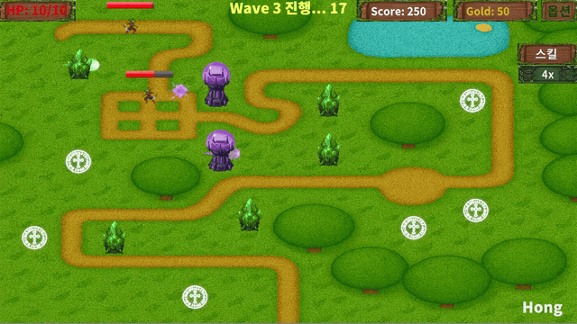
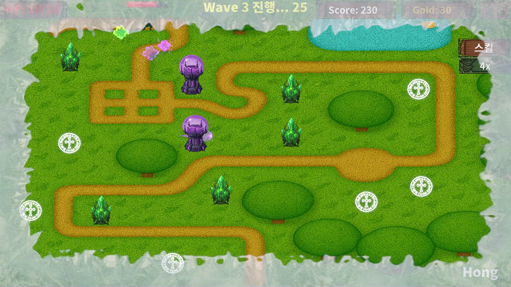

# D-Tower
> 타워를 배치하고 강화하며 30개 웨이브를 방어하는 2D 타워 디펜스 게임.

[게임 다운로드 · itch.io](https://hong0723.itch.io/d-tower)

## 플레이 영상 · 스크린샷

[전체 플레이 영상 · MP4](https://github.com/Hong0723/D-Tower/blob/Main/docs/media/gameplay.mp4) · [다운로드](https://github.com/Hong0723/D-Tower/raw/refs/heads/Main/docs/media/gameplay.mp4) · 1080p / 30fps

스크린샷 보기

## 게임 소개
제한된 골드로 타워를 설치·강화하고 스킬을 사용해 적의 이동 경로를 방어합니다. 웨이브가 진행될수록 강해지는 적에 맞춰 타워와 자원을 관리하는 게임입니다.

## 주요 특징
- 타워 설치 및 1~5단계 강화
- 번개·빙결·운석·통나무 스킬
- 총 30개 웨이브와 10·20·30번째 보스 웨이브
- 1·2·4·8·16배속 및 준비 시간 스킵
- 회원가입·로그인 및 클리어 점수 랭킹

## 개발 정보
| 항목 | 내용 |
| --- | --- |
| 개발 형태 | 팀 프로젝트 |
| 개발 환경 | Unity 2022.3.62f2, C# |
| 사용 기술 | Unity 2D, Firebase Authentication · Realtime Database |
| 담당 역할 | PM, 타워 로직 설계 및 구현 |

## 조작 방법
| 조작 | 기능 |
| --- | --- |
| 배치 지점 클릭 | 타워 설치·강화 |
| 스킬 버튼 및 대상 위치 선택 | 스킬 사용 |
| 배속 버튼 | 게임 속도 변경 |
| Skip | 준비 시간 넘기기 |
| Option | 일시정지 및 소리 설정 |

## 실행 방법
**배포 버전:** 위 itch.io 링크에서 내려받아 압축을 해제한 뒤 실행 파일을 실행합니다. 회원가입·로그인 후 게임을 시작할 수 있습니다.

**Unity 프로젝트:** 저장소를 내려받아 Unity Hub에서 프로젝트 루트를 추가하고 **Unity 2022.3.62f2**로 엽니다. 로그인·랭킹 기능은 Firebase 서비스 설정과 네트워크 연결이 필요합니다.

외부 에셋 및 라이브러리의 권리는 각 제작자에게 있습니다.

